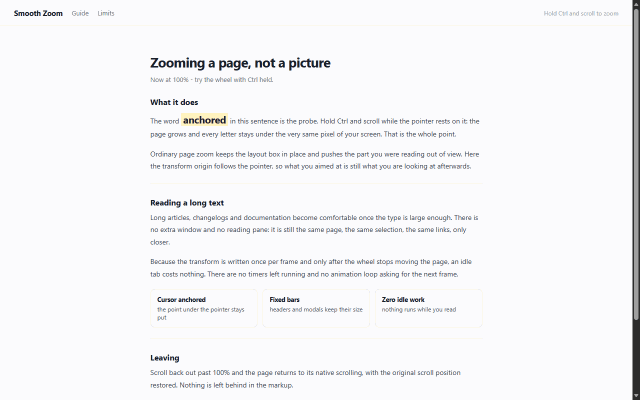

# Smooth Zoom to Cursor

> Trackpad-style smooth zoom to the cursor with Ctrl+Mouse Wheel.  
> One transform write per animation frame, zero work while idle. Crisp when settled, preserves fixed elements. Native Ctrl + / - zoom remains untouched.

**Author:** diple_df x claude

## Demo

The pointer rests on the word "anchored" the whole time. The page grows around it and the word
stays under the pointer, then everything returns to 100% with the original scroll position.
Recorded in a live session: one Ctrl+wheel gesture in and out, no scrolling, no re-anchoring.

## Installation

### Step 1 — Install a Userscript Manager

The script requires a browser extension to run. Supported managers:

| Extension | Chrome | Firefox | Edge |
|---|---|---|---|
| **Tampermonkey** (recommended) | ✓ | ✓ | ✓ |
| Violentmonkey | ✓ | ✓ | ✓ |
| Greasemonkey | — | ✓ | — |

Install the extension from your browser's official add-on store.

### Step 2 — Install the Script

**Option A — 1-click install (recommended):**

1. Click the automatic install link: **[Install Smooth Zoom to Cursor](https://raw.githubusercontent.com/diple-df/Smooth-Zoom/main/smooth-zoom.user.js)**
2. Tampermonkey will automatically intercept the file and open the installation prompt
3. Click **Install**

**Option B — manually:**

1. Copy the contents of `smooth-zoom.user.js`
2. Open Tampermonkey → **Create a new script**
3. Paste the code and press **Save** (`Ctrl+S`)

### Step 3 — Use It

Hold **Ctrl** and scroll the mouse wheel to smoothly zoom in/out to the cursor position. Scroll normally while zoomed in to pan around. Release/zoom out to return to normal view.

## Features

- **Smooth zoom to cursor** — Zoom is anchored to your mouse position, just like trackpad pinch-to-zoom
- **Frame-coalesced animation** — One `transform` write per animation frame; the loop stops when the zoom settles
- **Works on heavy pages** — Stays responsive even on complex sites
- **Preserves fixed elements** — Fixed elements keep their exact screen position and size at any zoom level
- **Native zoom intact** — Ctrl + / - keyboard zoom is not affected
- **Smart panning** — When zoomed in, mouse wheel scrolls the zoomed viewport
- **Auto-return** — Zooms back to normal when scale returns to 1

## How It Works

The script applies `transform: translate() scale()` to the document root and animates the
zoom with its own `requestAnimationFrame` loop — one transform write per frame, and the
loop stops completely once the zoom settles. Cursor anchoring is exact: the page point
under the cursor is recomputed on every wheel event and returned under the cursor at the
new scale (measured drift 0 across four zoom steps in headless Edge).

`position: fixed` elements get a counter-zoom `zoom: 1/scale` plus `left/top` in viewport
coordinates, so each keeps its exact screen rect at any zoom level (measured error
≤ 0.03 px across plain headers, `right:`/`bottom:` anchors, `inset: 0` layers and
absolute viewport overlays). The element's own `transform` (`translate(-50%, -50%)`
centring, `scale`, rotate animations) is never overwritten — measured on a rotating
loader: the alternative `position: absolute` + `transform: scale(1/scale)` approach
froze the animation and misplaced it 3.3 px.

Elements whose containing block is not the viewport — a `fixed` node inside an ancestor
with `transform`, `filter`, `contain` or `will-change` — are deliberately left alone,
because they already scale together with that ancestor.

`position: sticky` is intentionally not compensated: it lives in the normal flow and must
grow with the page like any other content. Pinning it by a one-axis offset was tried and
measured: the header returned to its screen position but its width grew 1193 → 1960 px at
164%, so it visibly jumped on every wheel step. A partially compensated element is worse
than a consistent one, so sticky is left alone.

### Elements that appear mid-zoom

A dialog, toast or dropdown created *while* you are already zoomed gets the same
compensation in the same frame: a batched MutationObserver (disconnected on exit) queues
new nodes, and their targets are measured with the root transform temporarily removed
inside one task, so no paint ever observes the intermediate state. Measured on a fixture
zoomed to 164%: a late toast with `bottom: 80px` lands exactly where it would at 100%
(676 + 44 = 720 px from the top), while without the mechanism it landed 1178 px lower.

### Web components and shadow DOM

Sites built with custom elements keep their fixed headers, toasts and side panels inside
a shadow root. The scan walks every reachable open shadow root up to six levels deep and
compensates those elements exactly like ordinary ones; closed shadow roots stay invisible
to any script. A fixed element nested inside an already-compensated fixed ancestor (a
dialog inside a full-screen popup layer) is pinned in screen coordinates without a second
counter-zoom, because its ancestor's frame already restores the viewport.

### Fixed elements that stretch instead of staying put

A fixed element stretched by `left`/`right` has no intrinsic width. Clearing `right` would leave width on `auto`, so the browser collapses the element to its content — a full-width header measured 1265 → 224 px. Width and height are pinned in pixels for every compensated element.

### Scroll lock and scrollbar width

While zoomed, the root gets `overflow: hidden` so the enlarged transform box cannot spawn
a scrollbar loop, and `scrollbar-gutter: stable` when the page had a visible scrollbar —
otherwise `clientWidth` would jump by the scrollbar width when the scrollbar disappears
and the cursor anchor would drift 7.5 px on the first step. Both are restored on exit.

### Absolute overlays pinned to the viewport

Not every overlay is `position:fixed`. Dialogs, modal masks, side panels and toasts are
often plain `position:absolute` elements with no positioned ancestor, which makes the
viewport their containing block. Under the page transform they scale with the document:
on a fixture, a full-screen mask grew from 1280×800 and a right-edge panel slid off
screen. They are detected (`offsetParent` is null, modulo a static body) and compensated
with the same law as fixed elements. Measured at 164%: mask, side panel, centred modal
and an off-screen tooltip all end at 0 px delta, while the article around them scales by
1.643 as it should.

### Wheel handling at idle

The non-passive wheel listener (the only kind that can `preventDefault` a browser zoom
gesture) does not sit on the page permanently: it would make Chrome wait on the main
thread before every native scroll. At idle there is only a passive scout that ignores
everything except `ctrlKey` and attaches the real listener on the first Ctrl+wheel
event; holding Ctrl down first attaches it from `keydown`.

## Technical Details

### Granted Permissions

The script uses two kinds of Tampermonkey storage/API grants: `GM_setValue` /
`GM_getValue` for settings, and `GM_xmlhttpRequest` (locked to
`raw.githubusercontent.com` / `github.com` via `@connect`) for the update check.
No other network access happens.

### Auto-update

Two layers, both pointing at the same raw file in this repository:

1. **Passive** — `@updateURL` / `@downloadURL` in the header. Tampermonkey
   checks them on its own schedule and offers the update.
2. **Active** — the script reads the remote `@version` itself:
   - once per day, in the background, after the page has loaded (idle callback,
     never during a zoom);
   - on demand from the Tampermonkey menu: **Smooth Zoom: Проверить обновления**.

   When the remote version is newer, a small banner appears in the corner with
   a link to the raw script. The banner is shown once per version; a manual
   check always shows the result, including "Установлена последняя версия".

Versions are compared field by field, so `2.10.0` correctly counts as newer than
`2.9.0` (a plain string comparison would get this wrong). The check costs one
`localStorage` read on start-up; the network is touched at most once a day.

### Settings

Key parameters can be adjusted in the script:
- `minScale`: 1 (minimum zoom)
- `maxScale`: 10 (maximum zoom)
- `wheelStep`: 0.0015 (zoom sensitivity)
- `panSpeed`: 1 (wheel pan speed while zoomed)
- `transitionMs`: 120 (smoothing: the zoom approaches its target exponentially, ~120 ms to visually settle)
- `crispDelayMs`: 200 (pause before the page is re-rasterized sharp)
- `shiftWheelHorizontal`: false (Shift+wheel pans horizontally)

### Performance

At most one `transform` write per animation frame, and exactly zero work while idle:
no animation loop, no timers, no MutationObserver, no wheel listener, no layout reads.
Measured in headless Edge: zero `requestAnimationFrame` calls during a one-second idle
window, both at rest and while zoomed-and-settled.

### Known limitations

- At the very edge of a page the cursor anchor is bounded by the pan limits
  (otherwise empty space would appear); this matches native page zoom.
- `position: sticky` elements stay in the normal flow and scale with the content
  during zoom; their screen position is not pinned (see the sticky note above).
- Pages that already apply `transform` or CSS `zoom` to `<html>` are left
  untouched so the script cannot corrupt their layout.
- Wheel input over a nested scrollable element pans the zoomed page, not that
  element.

