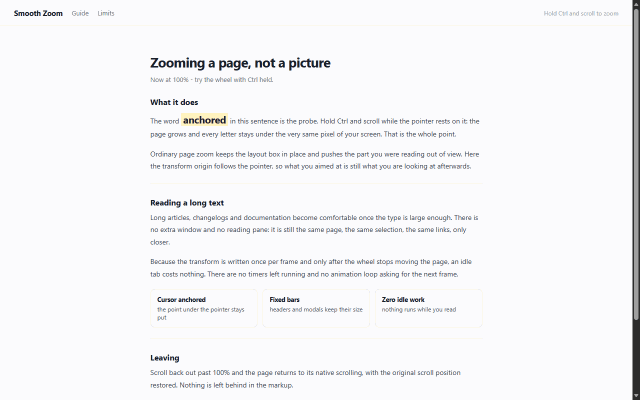

# Плавный зум к курсору (Smooth Zoom)

> Плавный зум к позиции курсора при прокрутке с зажатым Ctrl в стиле тачпада.  
> Анимация работает через CSS-трансформации с использованием композитора — остаётся плавной даже на тяжёлых страницах. Сохраняет корректное отображение фиксированных элементов. Стандартный зум Ctrl + / - не затрагивается.

**Автор:** diple_df x claude

## Демонстрация

Курсор всё время стоит на слове «anchored». Страница растёт вокруг него, слово остаётся под
курсором, а затем всё возвращается к 100% с исходной позицией прокрутки. Записано в живой
сессии: один жест Ctrl+колесо туда и обратно, без прокрутки и без повторного наведения.

## Установка

### Шаг 1 — Установите менеджер пользовательских скриптов

Скрипт работает через расширение-менеджер для браузера. Поддерживаются:

| Расширение | Chrome | Firefox | Edge |
|---|---|---|---|
| **Tampermonkey** (рекомендуется) | ✓ | ✓ | ✓ |
| Violentmonkey | ✓ | ✓ | ✓ |
| Greasemonkey | — | ✓ | — |

Установите расширение из официального магазина вашего браузера.

### Шаг 2 — Установите скрипт

**Вариант А — установка в один клик (рекомендуется):**

1. Нажмите на ссылку автоматической установки: **[Установить Smooth Zoom to Cursor](https://raw.githubusercontent.com/diple-df/Smooth-Zoom/main/smooth-zoom.user.js)**
2. Tampermonkey автоматически перехватит файл и откроет страницу установки
3. Нажмите **Установить**

**Вариант Б — вручную:**

1. Скопируйте содержимое файла `smooth-zoom.user.js`
2. Откройте Tampermonkey → **Создать новый скрипт**
3. Вставьте код и нажмите **Сохранить** (`Ctrl+S`)

### Шаг 3 — Использование

Зажмите **Ctrl** и прокрутите колесико мыши для плавного увеличения/уменьшения масштаба к позиции курсора. При увеличенном масштабе прокрутка колесиком перемещает обзор по странице. Когда масштаб вернётся к 1 — автоматически вернётся обычный режим просмотра.

## Возможности

- **Плавный зум к курсору** — Масштабирование привязано к положению курсора, как на тачпаде
- **Аппаратное ускорение** — Использует CSS-трансформации для максимальной плавности
- **Работает на тяжёлых страницах** — Не вызывает тормозов при зуме
- **Сохранение fixed-элементов** — Корректная работа с фиксированными и липкими элементами
- **Родной зум сохранён** — Горячие клавиши Ctrl + / - работают как обычно
- **Умная прокрутка** — При зуме колесико мыши прокручивает увеличенную область
- **Автовозврат** — Автоматически возвращается к обычному виду при масштабе 1

## Как работает

Скрипт применяет `transform: translate() scale()` к корневому элементу документа с плавными CSS-переходами, временно конвертирует элементы с `position: fixed` в `position: absolute` для корректного отображения, и управляет прокруткой через смещение трансформации.

## Техническая информация

### Права доступа

Скрипт использует `GM_setValue` / `GM_getValue` для настроек и
`GM_xmlhttpRequest` (ограничен `raw.githubusercontent.com` / `github.com` через
`@connect`) для проверки обновлений. Другого сетевого доступа нет.

### Автообновление

Два слоя, оба смотрят на один и тот же файл в этом репозитории:

1. **Пассивный** — `@updateURL` / `@downloadURL` в шапке. Tampermonkey сам
   сверяет версию по своему расписанию и предлагает обновление.
2. **Активный** — скрипт сам читает удалённый `@version`:
   - раз в сутки, фоном, после загрузки страницы (через idle callback, никогда
     во время зума);
   - по запросу из меню Tampermonkey: **Smooth Zoom: Проверить обновления**.

   Если версия новее — в углу появляется плашка со ссылкой на файл скрипта.
   Плашка показывается один раз на версию; ручная проверка всегда сообщает
   результат, включая «Установлена последняя версия».

Версии сравниваются по числовым сегментам, поэтому `2.10.0` корректно считается
новее `2.9.0` (обычное сравнение строк здесь ошибается). На старте проверка
стоит одно чтение `localStorage`; сеть трогается не чаще раза в сутки.

### Настройки

Основные параметры можно изменить прямо в коде скрипта:
- `minScale`: 1 (минимальный масштаб)
- `maxScale`: 10 (максимальный масштаб)
- `wheelStep`: 0.0015 (чувствительность зума)
- `panSpeed`: 1 (скорость прокрутки при зуме)
- `transitionMs`: 120 (длительность плавного перехода)
- `crispDelayMs`: 200 (пауза перед чёткой перерисовкой страницы)
- `shiftWheelHorizontal`: false (Shift+колесо — прокрутка по горизонтали)

### Нагрузка

Не больше одной записи `transform` за кадр, в покое скрипт не делает почти
ничего: нет цикла анимации, нет таймеров, обработчики ввода не читают layout,
`will-change` снимается сразу после остановки. Замерено в headless Edge: ноль
запросов кадра за секунду простоя.

### Известные ограничения

- У самого края страницы привязка к курсору ограничена границами панорамы
  (иначе появилась бы пустая область) — так же ведёт себя родной зум браузера.
- Элементы с `position: sticky` во время зума ведут себя как обычные: нативная
  прокрутка на время зума зафиксирована в 0.
- Страницы, у которых на `<html>` уже есть `transform` или CSS `zoom`, не
  обрабатываются, чтобы не сломать их раскладку.
- Колесо над вложенным скроллером двигает увеличенную страницу, а не его.

